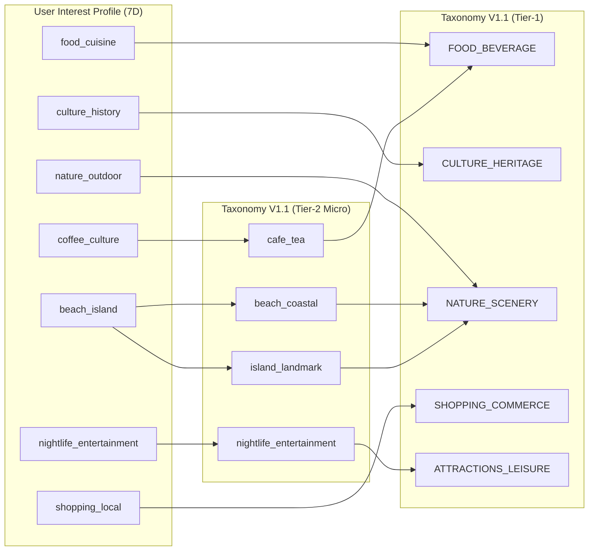

# GoMate REC-A Recommender Feature & Input Contract (V1)

**Specification Identifier:** `gomate-reca-feature-contract-v1`
**Version:** `1.1.0` (Audited & Reconciled with Dataset Freeze V2 / W4-GATE-01)
**Status:** RATIFIED & LOCKED (Audited Post-W3)
**Date:** 2026-10-13
**Branch:** `chore/w4-gate-01-reca-feature-contract`
**Target Consumer:** REC-A Recommender Baseline Track (`rec-a0`, `rec-a1`, Cold-Start Fallback)
**Upstream Source Model:** PostgreSQL `travel_preferences` table (`TravelPreference`)
**Authoritative Item Universe:** 622 Canonical Verified OSM POIs (`REC-A-CORE-V2` from [`gomate_places_freeze_v2.json`](file:///d:/Do_an/wanderai/data/curated/gomate_places_freeze_v2.json))

---

## 1. Executive Summary

This document establishes the authoritative feature contract between user travel preference profiles (`TravelPreference`) and the recommender item universe (`REC-A`) for the GoMate platform.

It defines:
1. **Canonical Interest Vocabulary:** A controlled 7-key vocabulary for new preference writes and recommendation feature vectors.
2. **Item Universe Boundaries:** Strict segregation between the **622 REC-A personalized core** places, the **626 map-discovery scope**, and the **137 secondary places**.
3. **Active vs. Stored Profile Attributes:** Rigorous distinction between active ranking signals (the 7 canonical interests) and stored profile fields (`travelStyle`, `budgetMin`, `budgetMax`, `preferredGroup`, `avoidances`, `dietaryNeeds`) that are preserved for product/profile functionality but **not consumed** by the current REC-A A0/A1 ranking function.
4. **POI Taxonomy Projection:** Deterministic semantic mapping from canonical user interests to GoMate Taxonomy V1.1 (Tier-1 macro domains and Tier-2 micro categories).
5. **Baseline Algorithmic & Cold-Start Semantics:** Mathematical formulations of `rec-a0` (taxonomy overlap) and `rec-a1` (cosine), cold-start fallback mechanics, and audited representation limitations.
6. **Backward Compatibility & Defense-in-Depth:** Permissive parsing of legacy free-form preferences combined with strict validation for new persistence operations.

---

## 2. Authoritative Item Universe: 622 vs. 626 vs. 137

The GoMate data foundation establishes strict boundaries between recommendation, map discovery, and secondary research corpora:

| Dataset Segment | Count | Scope & Destination Breakdown | Recommender Role |
| :--- | :--- | :--- | :--- |
| **`REC-A-CORE-V2`** | **622** | **Personalized Recommender Core:** • Đà Nẵng (`da-nang`): 289 • Hạ Long (`ha-long`): 188 • Hà Nội (`ha-noi`): 145 | **Exclusive Candidate Pool** for `rec-a0`, `rec-a1`, and cold-start personalization. Filtered by `is_rec_a_core_v2: true`. |
| **Map Discovery Scope** | **626** | **3-City Verified Map Catalog:** • Đà Nẵng: 293 (includes 4 secondary boundary POIs) • Hạ Long: 188 • Hà Nội: 145 | **Map/Spatial Browsing Only.** Must **NOT** be described as the REC-A personalized core universe. |
| **Secondary Corpus** | **137** | **Secondary Research Scope:** • Hội An: 50 • Huế: 50 • Nha Trang: 33 • Đà Nẵng outside core: 4 | **Strictly Excluded** from REC-A candidate universe (`is_rec_a_core_v2: false`). Secondary $\to$ REC-A leakage is exactly 0. |
| **Total Verified Places** | **759** | $622 + 137 = 759$ verified OSM places in Dataset Freeze V2 | Complete factual verified research corpus. |

---

## 3. Canonical Preference Vocabulary (7 Dimensions)

To eliminate free-text entropy and ensure reproducible feature vectors for recommendation algorithms without exposing low-level OSM tagging, all user interest inputs are restricted to the following 7 canonical keys:

| Canonical Key | Display Label (VI) | Description |
| :--- | :--- | :--- |
| `food_cuisine` | Ẩm thực & Đặc sản | Khám phá ẩm thực địa phương, nhà hàng, ẩm thực đường phố và đặc sản vùng miền. |
| `culture_history` | Văn hóa & Lịch sử | Tham quan di tích lịch sử, bảo tàng, chùa chiền, làng nghề truyền thống và kiến trúc cổ. |
| `nature_outdoor` | Thiên nhiên & Dã ngoại | Khám phá danh lam thắng cảnh, vườn quốc gia, hồ nước, leo núi và hoạt động ngoài trời. |
| `coffee_culture` | Cà phê & Trà quán | Trải nghiệm văn hóa cà phê Việt Nam, quán trà, không gian thư giãn và check-in. |
| `beach_island` | Biển đảo & Nghỉ dưỡng | Tắm biển, tham quan vịnh, đảo, hang động ven biển và hoạt động thể thao mặt nước. |
| `shopping_local` | Mua sắm & Chợ địa phương | Mua sắm đặc sản, quà lưu niệm, khám phá chợ truyền thống và trung tâm thương mại. |
| `nightlife_entertainment` | Giải trí & Đời sống về đêm | Phố đi bộ, quán bar, pub, biểu diễn nghệ thuật, chợ đêm và hoạt động giải trí đêm. |

### 3.1 User Vector Construction
For a given `TravelPreference` profile containing active interests $I \subseteq \mathcal{D}$:
- Projected into a 7-dimensional binary vector $u \in \{0, 1\}^7$.
- Duplicate interest selections do not amplify weight ($u_i \in \{0.0, 1.0\}$).
- Case and whitespace normalization occurs deterministically (lowercase, trimmed).
- Unknown canonical interests are not valid ranking features (rejected by public API validation, ignored by vectorizer).
- Vector Euclidean norm $\|u\|_2 = \sqrt{\sum_{i=1}^7 u_i^2} = \sqrt{|I|}$.
- If $\|u\|_2 = 0.0$ (empty or no valid canonical interests), the request routes to the deterministic cold-start fallback.

---

## 4. Preference $\to$ POI Taxonomy V1.1 Mapping & POI Representation

The recommender candidate selection and scoring engine projects canonical interest keys into POI taxonomy dimensions:

### 4.1 Detailed Mapping Rules (`recommendation/reca/contract.py`)

| Canonical Interest | Primary Tier-1 Macro Domain | Target Tier-2 Micro Categories | Fallback POI Category Slug |
| :--- | :--- | :--- | :--- |
| `food_cuisine` | `FOOD_BEVERAGE` | `restaurant_dining`, `street_food`, `street_food_market`, `seafood_dining` | `restaurant`, `food` |
| `culture_history` | `CULTURE_HERITAGE` | `temple_pagoda`, `religious_temple`, `museum_gallery`, `historic_monument`, `heritage_craft` (or Tier-1 `CULTURE_HERITAGE`) | `culture`, `temple`, `museum` |
| `nature_outdoor` | `NATURE_SCENERY` | `park_garden`, `cave_grotto`, `lake_river`, `zoo_wildlife`, `scenic_viewpoint`, `viewpoint_scenic` | `nature`, `park` |
| `coffee_culture` | `FOOD_BEVERAGE` | `cafe_tea` *(Does not automatically imply `food_cuisine` unless explicit dining subtype)* | `cafe` |
| `beach_island` | `NATURE_SCENERY` | `beach_coastal`, `island_landmark` | `beach` |
| `shopping_local` | `SHOPPING_COMMERCE` | `traditional_market`, `shopping_mall`, `souvenir_craft` | `market` |
| `nightlife_entertainment` | `ATTRACTIONS_LEISURE` | `nightlife_entertainment` *(Generic attractions, iconic landmarks, theme parks do NOT map to nightlife)* | `nightlife` |
| *(None)* | `HOSPITALITY` | `hotel_resort`, `homestay_hostel` *(No activity feature mapping in REC-A V1; yields $[0.0]^7$)* | `hotel` |

> [!NOTE]
> Generic `category=attraction` is not itself a canonical-interest signal. Unless taxonomy/tags resolve it to a supported specific subtype, it remains `tier_2=attraction` and produces a zero canonical-interest vector.

### 4.2 Current Audited POI Vector Distribution
Across all **622 `REC-A-CORE-V2` places**:
- **Binary 7D vector:** $p \in \{0, 1\}^7$.
- **Non-Zero Vectors (I0):** 405 POIs (65.11%).
- **Zero-Vectors (I1):** 217 POIs (34.89%).
- **Multi-Interest POIs:** **0 POIs**. Maximum active canonical dimensions per POI is exactly 1.
- **Active Dimension Histogram:** `{1: 405, 0: 217}`.

#### Canonical Interest Counts Across Core POIs:
- `food_cuisine`: 110 POIs
- `culture_history`: 106 POIs
- `coffee_culture`: 78 POIs
- `shopping_local`: 39 POIs
- `nature_outdoor`: 30 POIs
- `nightlife_entertainment`: 28 POIs
- `beach_island`: 14 POIs
*(Sum of active dimensions = 405)*.

#### Zero-Vector Breakdown (217 POIs):
- `hotel`: 150 POIs (pure accommodation places without activity taxonomy mapping)
- `attraction`: 63 POIs (iconic landmarks, ferry/boat terminals, and generic attractions without specific activity tags)
- `entertainment`: 4 POIs (theme parks / leisure venues without nightlife tags)
*(100% of the 217 zero-vector POIs retain usable category slugs and contract taxonomy Tier-1 metadata: `HOSPITALITY`: 150, `ATTRACTIONS_LEISURE`: 56, `TRANSPORT_HUBS`: 11)*.

---

## 5. Profile Fields — Critical Semantics (Active vs. Stored)

The GoMate user profile database model (`travel_preferences`) and API DTOs support multiple user preference dimensions. For the **current REC-A A0/A1 ranking function**, these fields are **NOT active ranking signals**.

They are classified as:
> **`AVAILABLE_USER_FEATURE_NOT_USED_IN_V1`**
> Stored and profile-supported in PostgreSQL and API DTOs, but not consumed by the current REC-A ranking function. Reserved for future/context-aware recommendation work; not part of the current A0/A1 canonical ranking information set.

| Profile Field | Model & Schema Type | Current REC-A Status | Recommender Behavior & Manifest Reason |
| :--- | :--- | :--- | :--- |
| `travelStyle` | Enum `TravelStyle` (`BACKPACKER`, `BUDGET`, `COMFORT`, `LUXURY`) | **NOT USED IN RANKING** | *Reason:* No validated POI-side travel-style compatibility signal exists in Dataset Freeze V2. Stored for user profile display and future accommodation tier matching. |
| `budgetMin` | Integer (VND) $\ge 0$ | **NOT USED IN RANKING** | *Reason:* POI price data is not reliably standardized in OSM/Overture factual dataset. Stored for future budget-aware trip planning. |
| `budgetMax` | Integer (VND) $\ge \text{budgetMin}$ | **NOT USED IN RANKING** | *Reason:* POI price data is not reliably standardized in OSM/Overture factual dataset. Stored for future budget-aware trip planning. |
| `preferredGroup` | Enum `GroupSize` (`SOLO`, `COUPLE`, `SMALL_GROUP`, `LARGE_GROUP`, `FAMILY`) | **NOT USED IN RANKING** | *Reason:* Group dynamics and party size constraints are not modeled in REC-A baseline. Stored for future Buddy Matching and group itinerary filtering. |
| `avoidances` | String Array (e.g. `['crowds', 'heights']`) | **NOT USED IN RANKING** | *Reason:* Negative preference filtering is deferred to post-filtering in later milestones. |
| `dietaryNeeds` | String Array (e.g. `['vegetarian', 'vegan', 'halal']`) | **NOT USED IN RANKING** | *Reason:* Detailed dietary certification is not universally populated in OSM nodes. Stored for future dining-specific filtering. |

**Runtime Contract:** Every recommendation API response from `POST /recommendations/places` explicitly returns the `unsupported_user_features` manifest detailing each unused field and its operational reason. Clients supplying these fields will have them accepted without error, but ranking order is identical to requests supplying only `interests`.

---

## 6. Baseline Algorithms & Audited Representation Limitation

### 6.1 REC-A0: Taxonomy Match Overlap Baseline
`REC-A0` computes an unnormalized overlap count reflecting how many canonical interest domains are simultaneously active in both the user profile and the place:

$$\text{score}_{\text{A0}}(u, p) = \sum_{i=1}^7 \min(u_i, p_i) \quad \text{for } u_i > 0 \land p_i > 0$$

- **Score Range:** $[0.0, 1.0]$ in practice (since max active dimensions per current POI is 1).
- **Strategy Code:** `rec-a0_content_match`.

### 6.2 REC-A1: Cosine Content-Based Vector Baseline
`REC-A1` normalizes for user vector length by computing the cosine similarity between the 7D user vector and the 7D item vector:

$$\text{score}_{\text{A1}}(u, p) = \frac{u \cdot p}{\|u\|_2 \|p\|_2} = \frac{\sum_{i=1}^7 u_i p_i}{\sqrt{\sum_{i=1}^7 u_i^2} \sqrt{\sum_{i=1}^7 p_i^2}}$$

- **Score Range:** $[0.0, 1.0]$. If $\|u\|_2 = 0$ or $\|p\|_2 = 0$, $\text{score}_{\text{A1}}(u, p) = 0.0$.
- **Strategy Code:** `rec-a1_content_match`.

### 6.3 Audited Representation Limitation: Effective Rank Equivalence
Because every non-zero POI in `REC-A-CORE-V2` has exactly one active canonical interest ($\|p\|_2 = 1.0$):
$$\text{score}_{\text{A1}}(u, p) = \frac{\text{score}_{\text{A0}}(u, p)}{\|u\|_2}$$
For any given user query with fixed interests, $\|u\|_2$ is a constant scaling factor. Consequently:
- For any user profile, dividing all candidate scores by a positive constant does not change their relative ordering.
- In the audited N300 benchmark (300 profiles $\times$ Top-10), `REC-A0` and `REC-A1` produce the **identical Top-10 place ID ranking order** across all 300 profiles.
- **Scientific Disclosure:** `REC-A0` and `REC-A1` are **two distinct mathematical scoring implementations**, but under the current single-interest POI representation they form **one effective ranking baseline**. They must **NOT** be presented as two independent ranking comparators in the thesis evaluation.

### 6.4 Deterministic Tie-Breaking
When candidates achieve identical scores, GoMate applies a strict 3-tuple sort key:

$$\text{SortKey}(item) = (-\text{score}, \text{NormalizeString}(name), \text{place\_id})$$

Where `NormalizeString` removes diacritics, strips punctuation, and lowercases text. Ranking is bit-identical and reproducible across runs.

---

## 7. Cold-Start Semantics (`COLD_START_DIVERSE_CATALOG_BASELINE`)

When a user has no persisted preferences, empty interests, or completely unrecognized tags ($\|u\|_2 = 0$):
1. **Never Fabricate Popularity:** GoMate does not invent ratings, review counts, or popularity metrics.
2. **Stratified Domain Interleaving:** Candidates are partitioned by contract taxonomy domain (`CULTURE_HERITAGE`, `NATURE_SCENERY`, `FOOD_BEVERAGE`, `SHOPPING_COMMERCE`, `ATTRACTIONS_LEISURE`, `HOSPITALITY`, `TRANSPORT_HUBS`).
3. **Round-Robin Selection:** The engine samples items across distinct domains using deterministic sorting `(NormalizeString(name), place_id)`.
4. **Deterministic Pseudo-Score:**
   $$\text{score}(rank) = 1.0 - \frac{rank - 1}{n} \times 0.9$$
   *(Where $n = \text{top\_k}$)*.
   > [!IMPORTANT]
   > The cold-start fallback pseudo-score is a **deterministic rank-derived display signal only**. It must **NEVER** be described as:
   > - a probability
   > - human relevance
   > - a rating
   > - algorithmic confidence
5. **Metadata & Audit Trails:** Tagged with `cold_start: true`, `algorithm: "COLD_START_DIVERSE_CATALOG_BASELINE"`, `strategy: "COLD_START_DIVERSE_CATALOG_BASELINE"`, and reason code `COLD_START_DIVERSE_FALLBACK`.

---

## 8. Backward Compatibility & Defense-in-Depth

1. **Permissive Legacy Read:**
   - Pre-existing user profiles or benchmark datasets may contain legacy string tags. `GET /users/me` returns these tags without throwing validation errors.
2. **Strict Canonical New Writes:**
   - Any `PUT /users/me/preferences` invocation must pass strict validation against `CANONICAL_INTERESTS`.
   - Unknown canonical keys, negative budgets, inverted budget ranges, or disallowed attributes are rejected with HTTP 400.
3. **Field Whitelisting:**
   - Unsupported or un-migrated fields (`pace`, `presence`, `online`, `showActivityStatus`, `userId`) are rejected by NestJS `ValidationPipe({ forbidNonWhitelisted: true })`.

---

## 9. Scientific Limitations & Research Boundaries

- **Fixed Item Universe:** Recommender candidate selection evaluates strictly against the **622 canonical verified OSM POIs** (`REC-A-CORE-V2`) frozen in [`data/curated/gomate_places_freeze_v2.json`](file:///d:/Do_an/wanderai/data/curated/gomate_places_freeze_v2.json).
- **Candidate Pool Limitation:** 217 core POIs (34.89%) have zero-vectors under the 7 canonical activity interests (primarily hotels and generic landmarks), meaning they can only score 0.0 in activity matching and appear in cold-start or tie scenarios.
- **Top-K Catalog Concentration:** In unconstrained global ranking ($K=10$), deterministic lexical tie-breaking results in 52 unique items recommended across 300 synthetic profiles (8.36% catalog coverage).
- **No A2 Implementation:** Diversity-aware reranking (A2) is a research candidate only. It is **NOT implemented** in production and is **NOT** the final selected model.
- **No Collaborative Filtering in REC-A:** Collaborative filtering models and latent factor transfers are strictly out of scope for REC-A. ViHoRec is a separate, restricted benchmark corpus and its hotel IDs must never be merged with GoMate POI UUIDs.
- **No Human Ground Truth in W3:** The N300 benchmark is an engineering determinism track only. Scientific evaluation against independent human relevance judgments is deferred to `REC-EVAL-01` (Week 5).
